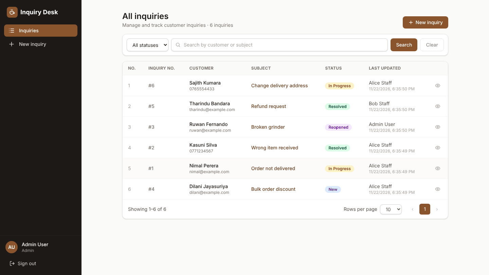
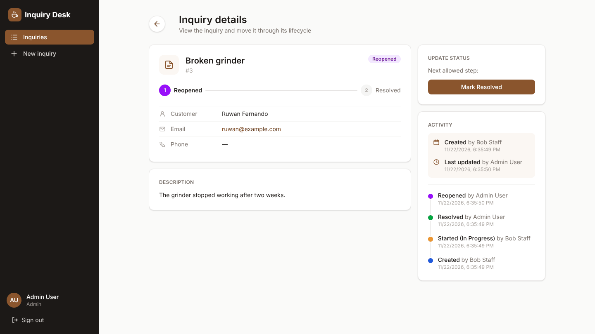
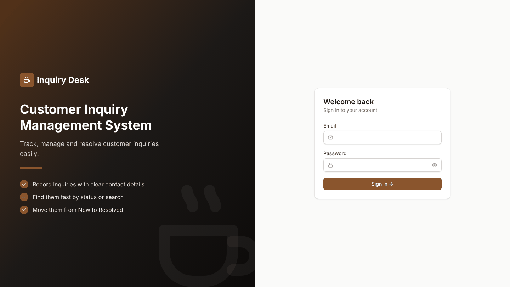
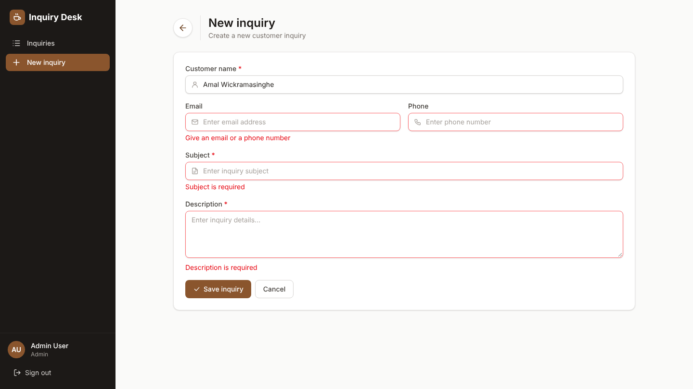

# ☕ Inquiry Desk

**A small web app for tracking customer inquiries.**
Staff sign in, record an inquiry, find it later, and move it through **New → In Progress → Resolved**.
Every create and status change is saved with who did it and when.


> [!NOTE]
> Built for the **Coffee Ninja Full-Stack Intern** assessment.
> Design choices, trade-offs and AI use are in **[DECISIONS.md](DECISIONS.md)**.



## 📑 Contents

- [Screenshots](#-screenshots)
- [Tech stack](#-tech-stack)
- [Setup](#-setup)
- [Test accounts](#-test-accounts)
- [Running the tests](#-running-the-tests)
- [Features](#-features)
- [The three situations from the brief](#-the-three-situations-from-the-brief)
- [API overview](#-api-overview)
- [Folder structure](#-folder-structure)

## 📸 Screenshots

**Inquiry details**: status steps, allowed next action, activity timeline



| Sign in | New inquiry (validation) |
|---|---|
|  |  |

## 🧰 Tech stack

| Part | Tools |
|---|---|
| Frontend | React 19 + Vite, React Router, Tailwind CSS v4 |
| Backend | Node.js + Express 5 (ES modules) |
| Database | PostgreSQL, `pg` with plain SQL, `.sql` migration files |
| Auth | bcrypt + JWT in an **httpOnly cookie** |
| Validation | zod (API) + checks in the form + `CHECK` constraints in the database |
| Tests | Jest + Supertest (backend), Vitest + React Testing Library (frontend) |

## 🚀 Setup

**You need:** Node.js 22 (tested with 22.17), PostgreSQL 17 (any recent version should work), Git.

### Step 1 – Clone

```bash
git clone https://github.com/SandaruwanChandrasena/inquiry-desk.git
cd inquiry-desk
```

### Step 2 – Create the database

In `psql` (or pgAdmin):

```sql
CREATE DATABASE inquiry_desk;
```

### Step 3 – Backend

```bash
cd backend
npm install
cp .env.example .env        # Windows (cmd): copy .env.example .env
```

Open `.env` and change **two** values:

| Key | Value |
|---|---|
| `DB_PASSWORD` | your PostgreSQL password |
| `JWT_SECRET` | any long random string |

Create the tables and the test accounts, then start the API:

```bash
npm run migrate
npm run seed
npm run dev
```

✅ The API runs on **http://localhost:4000**. Check it at http://localhost:4000/api/health.

### Step 4 – Frontend

Open a **second terminal**:

```bash
cd frontend
npm install
npm run dev
```

✅ Open **http://localhost:5173** and sign in with a [test account](#-test-accounts).

> [!IMPORTANT]
> Start the **backend first**. The Vite dev server forwards `/api` requests to port 4000,
> so the browser sees one site: the login cookie works and no CORS setup is needed.

## 🔐 Test accounts

| Email | Role | Sees |
|---|---|---|
| `alice@example.com` | staff | only inquiries Alice created |
| `bob@example.com` | staff | only inquiries Bob created |
| `admin@example.com` | admin | all inquiries |

> [!TIP]
> The password for all accounts is **`Password123!`**

## 🧪 Running the tests

| Part | Command | Tests | What they need |
|---|---|---|---|
| Backend | `cd backend` → `npm test` | 12 | `npm run migrate` + `npm run seed` first (tests log in as Alice and Bob) |
| Frontend | `cd frontend` → `npm test` | 4 | nothing (no backend or database) |

> [!NOTE]
> Backend tests use the same database as the dev server. Each run deletes only the rows it created.

## ✨ Features

- **Sign in / out**: the API checks the cookie on every inquiry request (401 if missing or invalid).
  An expired login sends the user back to the sign-in page.
- **New inquiry**: customer name, email and/or phone (at least one), subject, description.
- **Inquiry list**: status badge, status filter, search by name or subject, 5 / 10 / 20 per page.
- **Detail page**: status steps, only the allowed next action as a button, and an activity timeline.
- **Status rules**: New → In Progress → Resolved. Resolved can be reopened (back to In Progress),
  and a reopened inquiry is shown as **"Reopened"**.
- **Clear states**: loading, empty, error with "Try again", save failed, not found.

## 🎯 The three situations from the brief

| Situation | How to see it | Result |
|---|---|---|
| ✍️ Missing or invalid input | Open **New inquiry** and press **Save** with empty fields. | The form shows the errors. The API also rejects bad data on its own (**400**). The same open inquiry twice gives **409**. |
| 🗂️ Two tabs, stale data | Open the same inquiry in two tabs. Change the status in tab 1, then try in tab 2. | Tab 2 gets "changed by someone else" (**409**) and a **Reload** button. |
| 🔒 Direct link to someone else's inquiry | As Alice, create an inquiry and copy its URL. Sign in as Bob and open it. | Bob sees "not found". The API returns **404**, so it does not even reveal that the inquiry exists. |

## 🔌 API overview

All inquiry routes need a signed-in user.

<details>
<summary><b>Show endpoints</b></summary>

| Method | Path | What it does |
|---|---|---|
| `POST` | `/api/auth/login` | Sign in, sets the cookie |
| `POST` | `/api/auth/logout` | Clears the cookie |
| `GET` | `/api/auth/me` | Current user |
| `GET` | `/api/inquiries?status=&search=` | List (own inquiries, or all for admin) |
| `GET` | `/api/inquiries/:id` | One inquiry + its history |
| `POST` | `/api/inquiries` | Create |
| `PATCH` | `/api/inquiries/:id/status` | Change status. Body: `{ "status": "in_progress", "version": 1 }` |

**Error codes**

| Code | Meaning |
|---|---|
| 400 | Invalid input or ID |
| 401 | Not signed in |
| 404 | Not found, or not yours |
| 409 | Duplicate open inquiry, or changed by someone else |
| 422 | Status change not allowed |

</details>

## 📁 Folder structure

```
inquiry-desk/
├── backend/
│   ├── db/              migrations (.sql), migrate.js, seed.js
│   ├── src/
│   │   ├── routes/      HTTP: read the request, send the response
│   │   ├── models/      SQL queries
│   │   ├── middleware/  requireAuth, errorHandler
│   │   ├── validation/  zod schemas
│   │   └── utils/       status rules
│   └── tests/
├── frontend/
│   └── src/
│       ├── api/         fetch helper
│       ├── context/     signed-in user
│       ├── components/  layout, form, badges, timeline
│       ├── pages/       login, list, new, detail, 404
│       └── tests/
└── docs/screenshots/
```
